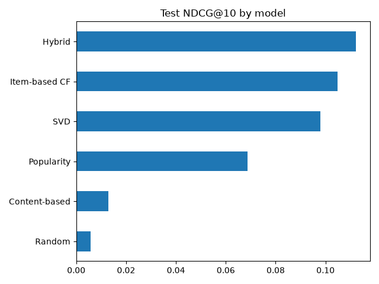

# Hybrid Movie Recommender (MovieLens)

A recommendation system that ranks movies for each user, compares four approaches plus a tuned hybrid, and serves recommendations through a Streamlit app.

## What I did
- Built a sparse user-item matrix from MovieLens ratings (about 98% sparse) and filtered very low-activity users and movies
- Split each user's history by time (70% train, 10% validation, 20% test) so the model predicts the future, not the past
- Implemented Popularity (Bayesian average), Content-based (TF-IDF on genres), Item-based CF (mean-centered cosine similarity with shrinkage) and SVD matrix factorization
- Tuned SVD components and the hybrid blend weights on the validation set only
- Evaluated with Precision@10, Recall@10, NDCG@10, Hit rate and catalog coverage, and RMSE for rating prediction
- Built a Streamlit app that recommends movies from a user's favourites

## Results (test set, last 20% of each user's history)
| Model | NDCG@10 | Hit rate@10 | Coverage |
|---|---|---|---|
| Random | 0.xx | 0.xx | 0.xx |
| Popularity | 0.xx | 0.xx | 0.xx |
| Content-based | 0.xx | 0.xx | 0.xx |
| Item-based CF | 0.xx | 0.xx | 0.xx |
| SVD | 0.xx | 0.xx | 0.xx |
| Hybrid | 0.xx | 0.xx | 0.xx |

Rating prediction RMSE: global mean 0.xx, user mean 0.xx, SVD 0.xx

## How to run
pip install -r requirements.txt
python train.py
streamlit run app.py

## Limitations
- Small dataset (100k ratings), so results have noticeable variance
- Cold start: new users need a few favourite movies, and new movies need some ratings
- Offline metrics only; real quality would need an online A/B test
- "Relevant" is defined as a rating of 4 or more, which is an assumption

## Tech stack
Python, pandas, NumPy, SciPy, scikit-learn, matplotlib, Streamlit